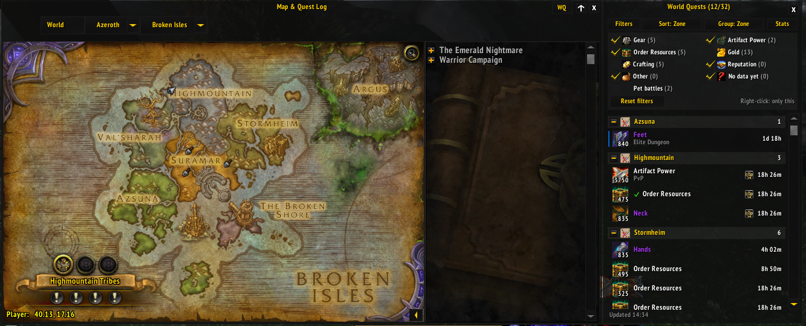
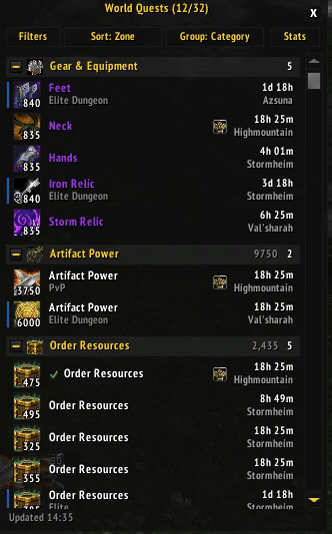

# World Quest Board

See every world quest and its reward in one list next to your world map. No more hovering over every pin to find the gear, Artifact Power, Order Resources or gold.



> **Only for Legion 7.3.5**, the version used by Legion private servers such as Tauri. It does **not** work on today's official World of Warcraft.

## How to use it

Press **M** to open the world map. The **World Quests** list appears next to it.

- On the **small map**, the list sits along the map's right side.
- On the **fullscreen map**, the list covers the right edge of the map. Drag it by its title to move it anywhere.
- Click the **WQ** button at the top of the map to hide or show the list.



## What you get

- Quests grouped by reward (gear, Artifact Power, gold, …) or by zone, with totals.
- Filters to hide the rewards you don't care about.
- Click a quest to find it on the map.
- The item level or amount printed right on each reward icon.
- Your own world quest statistics: quests done, gold and Order Resources earned, best gear.
- Matches the look of ElvUI if you use it, and works with TomTom waypoints. Neither is needed.
- All Broken Isles and Argus world quests in one list, right beside the map.

## How to install

1. **Download.** At the top of this page, click the green **Code** button, then **Download ZIP**.
2. **Unzip.** Right-click the downloaded file and choose **Extract All…**.
3. **Find the addon folder.** Open the extracted folders until you see the addon's files: `Core`, `Panel`, `WorldQuestBoard` and a few more. The folder that holds them is the one you want. It's called `WorldQuestBoard-master`.
   > Windows usually puts a folder inside a folder with the same name: `WorldQuestBoard-master\WorldQuestBoard-master`. Use the **inner** one.
4. **Rename** that folder to exactly **`WorldQuestBoard`**. WoW won't load it under any other name.
5. **Open your WoW folder.** That's the folder with `Wow.exe` (or `Wow-64.exe`) in it. Inside, open `Interface`, then `AddOns`. If either folder doesn't exist, create it.
6. **Move** your `WorldQuestBoard` folder into `AddOns`. It should end up like this:
   ```
   Your WoW folder
   └── Interface
       └── AddOns
           └── WorldQuestBoard
               ├── Core.lua
               ├── WorldQuestBoard.toc
               └── (more files)
   ```
7. **Start WoW.** If it's already running, quit completely and start it again. WoW only finds new addons when it starts.
8. **Turn it on.** On the character select screen, click **AddOns** (bottom-left corner) and make sure **World Quest Board** is ticked. If it says "Out of date", also tick **Load out of date AddOns**.

### Mouse controls

| Do this                                    | What happens                                                                                       |
| ------------------------------------------ | -------------------------------------------------------------------------------------------------- |
| Click a quest                              | The map jumps to that zone and the quest gets a pulsing ring                                       |
| **Shift** + click a quest                  | Track or stop tracking it. If you're typing in chat, the quest link goes into your message instead |
| **Ctrl** + click a quest                   | Add a TomTom waypoint (needs the TomTom addon)                                                     |
| Hold **Shift** while hovering a gear quest | Compare the reward with what you're wearing                                                        |
| Click a group's title                      | Fold or unfold that group                                                                          |

### Buttons at the top

- **Filters:** shows the list of reward types. Click a type to hide or show it.
  - **Right-click** a type to show _only_ that type.
  - **Pet battles** hides or shows all pet battle quests, whatever their reward.
  - **Reset filters** shows everything again.
- **Sort:** changes the order: time left, zone, reward amount or quest name. Each click picks the next one.
- **Group:** switches between grouping by reward (**Category**) and by **Zone**.
- **Stats:** opens your statistics (see below).

Your choices are remembered next time you play: filters, sorting, grouping, folded groups and where you put the list.

### Reward groups

Each quest is listed in one group only.

| Group (name in Filters)           | What's in it                                                                                            |
| --------------------------------- | ------------------------------------------------------------------------------------------------------- |
| Gear & Equipment (Gear)           | Weapons, armour and artifact relics                                                                     |
| Artifact Power                    | Artifact Power                                                                                          |
| Order Resources                   | Order Resources                                                                                         |
| Gold                              | Gold                                                                                                    |
| Crafting & Professions (Crafting) | Trade goods and recipes                                                                                 |
| Reputation                        | Reputation tokens, or quests that only give reputation                                                  |
| Other Rewards (Other)             | Everything else: Nethershards, Veiled Argunite, other items, honor                                      |
| Reward Data Pending (No data yet) | The game hasn't sent the reward yet. These quests move to the right group by themselves once it arrives |

If a quest gives more than one reward, it goes in whichever group comes first in this table. For example, a quest that gives gear _and_ gold is listed under Gear & Equipment.

Each group's title shows how many quests it has. Artifact Power, Order Resources and Gold also show how much you could earn in total.

## Statistics

Click **Stats** at the top of the list to see, for the character you're playing:

- How many world quests you've completed
- How much gold you've earned from world quests
- How many Order Resources you've earned from world quests
- Your best gear from a world quest (hover it to see the item)
- Your latest completed quests and what each one gave you

Good to know:

- **Counting starts when you install the addon.** Quests done before that, or while the addon was turned off, aren't counted.
- It keeps counting while the map is closed.
- Emissary quests and bonus objectives don't count.
- **Gold and Order Resources** are only added when the addon sees your gold or resources actually go up. If it can't confirm that, the quest still counts, but its gold or resources aren't added. The quest is marked "rewards unconfirmed". This is rare.
- **Gear** counts the item you actually got, so Warforged and Titanforged upgrades are included. If the item was sent to your mailbox instead, the quest's listed item level is used and marked "(listed item level)".
- Each character has its own statistics, and keeps them if renamed.

**Starting over:** click **Reset statistics...** at the bottom of the statistics window, then click **Yes, reset** within 15 seconds. Only the character you're playing is reset.

## Chat commands

You don't need these for normal use, but they can help. To use one, press **Enter**, type the command, and press **Enter** again.

| Command                     | What it does                                                                                                 |
| --------------------------- | ------------------------------------------------------------------------------------------------------------ |
| `/wqb`                      | Show or hide the list                                                                                        |
| `/wqb stats`                | Open or close the statistics                                                                                 |
| `/wqb reset filters`        | Show all reward types again                                                                                  |
| `/wqb reset position`       | Move the list and the statistics window back to where they started                                           |
| `/wqb reset all`            | Reset all of this addon's settings (filters, sorting, positions). Your statistics are kept                   |
| `/wqb lock` / `/wqb unlock` | Stop or allow dragging the list                                                                              |
| `/wqb skin`                 | Turn the ElvUI look off or on. Then type `/reload`, which reloads the game's interface (takes a few seconds) |
| `/wqb resetstats`           | Reset this character's statistics (asks you first)                                                           |
| `/wqb help`                 | List all commands in chat                                                                                    |

`/worldquestboard` works the same as `/wqb`.

These three are only for checking problems and reporting bugs:

| Command      | What it does                                                                                         |
| ------------ | ---------------------------------------------------------------------------------------------------- |
| `/wqb scan`  | Shows how many quests the addon found, and how many are still loading                                |
| `/wqb aptip` | Shows how the addon reads Artifact Power amounts                                                     |
| `/wqb log`   | Writes a chat message each time a quest or reward is added to your statistics. Type it again to stop |

## Using ElvUI or TomTom?

- **ElvUI:** the list and statistics window take on ElvUI's look by themselves. This is skipped if you've turned off ElvUI's Blizzard skins or its World Map skin (`/ec` → Skins). To turn it off yourself, type `/wqb skin` and then `/reload`.
- **TomTom:** hold **Ctrl** and click a quest to set a waypoint to it.

## Something not working?

**World Quest Board isn't in the AddOns list.**
The folder is named wrong or in the wrong place. It must be called exactly `WorldQuestBoard` (not `WorldQuestBoard-master`), sit inside `Interface\AddOns`, and have the addon's files directly inside it, not another folder. Then quit WoW completely and start it again.

**It says "Out of date".**
Tick **Load out of date AddOns** on the AddOns screen.

**The list doesn't appear when I open the map.**

1. Type `/wqb show`.
2. Still nothing? Type `/wqb reset position`. It may have been dragged off the screen.
3. Check that your character is level 110 and has unlocked world quests.

**The list covers my fullscreen map.**
Drag it by its title, or click **WQ** at the top of the map to hide it.

**Some quests are missing, or are under "Reward Data Pending".**
The game is still sending quest information. Give it a moment: the list updates by itself. The bottom of the list shows how many quests are still "waiting for server data".

**An Artifact Power amount or item level is missing or looks wrong.**
These numbers appear once the game has loaded the reward's details, so give it a moment. If one still looks wrong, type `/wqb aptip`, take a screenshot and report it (see the end of this page).

## Things it can't do

The 7.3.5 game doesn't give addons this information, so:

- Reputation quests show the faction, but not how much reputation you get.
- The item level shown is the quest's normal reward. Warforged and Titanforged upgrades only show once you get the item.
- Time left sometimes shows "--" when the server doesn't say.
- Shift-click tracking is turned off during combat, to avoid WoW's "action blocked" error.
- The list only updates while the map is open. (Your statistics are still counted when it's closed.)

## Updating

1. Delete the old `WorldQuestBoard` folder from `Interface\AddOns`.
2. Download the new version and install it the same way as above, including the rename.

Your settings and statistics are saved somewhere else, so you won't lose them.

## Uninstalling

Delete the `WorldQuestBoard` folder from `Interface\AddOns`.

To also delete your settings and statistics, delete this file:
`Your WoW folder\WTF\Account\(your account name)\SavedVariables\WorldQuestBoard.lua`

## Found a bug? Have an idea?

Please [open an issue on GitHub](https://github.com/stefansretenovic01/WorldQuestBoard/issues) (you'll need a free GitHub account). It helps a lot to include:

- What you did, what you expected, and what happened instead.
- A screenshot taken right after typing `/wqb scan` in chat. Press **Print Screen** to take it; WoW saves it in the `Screenshots` folder inside your WoW folder.
